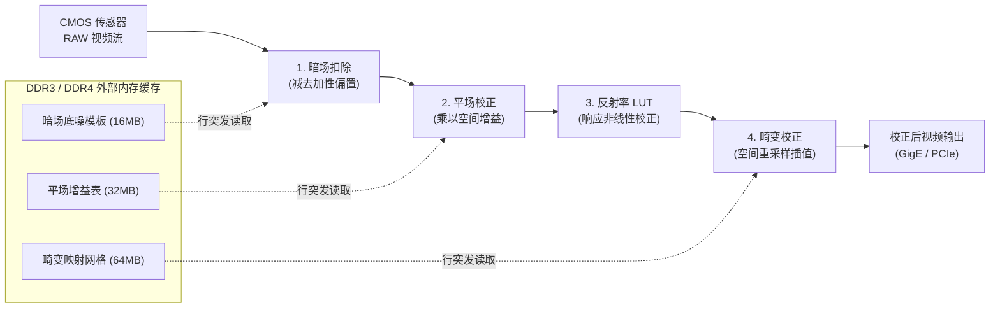
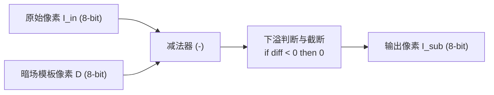
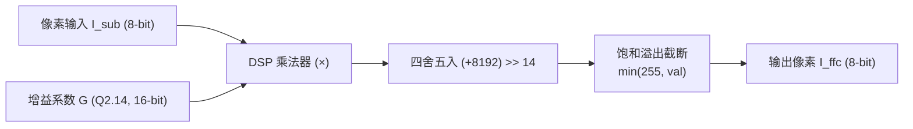
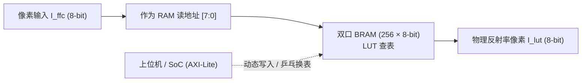
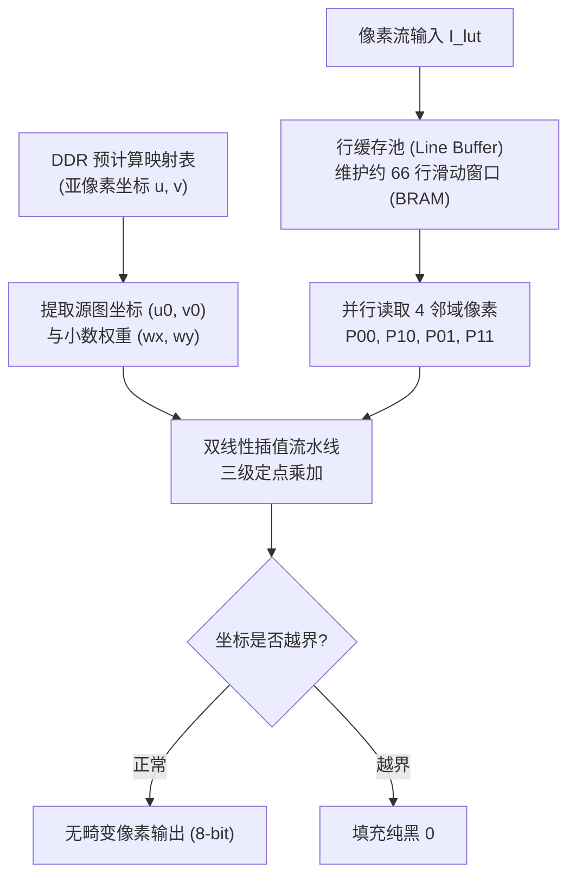

# 工业相机内置实时图像校正 FPGA 开发需求说明书（简明版）

- **文档目的**：向相机 FPGA 开发人员明确在线实时校正算法的开发功能、性能指标、流水线顺序及每个模块的输入/输出与计算逻辑。
- **关联算法**：`WaferCalibSDK` 工业晶圆标定与检测系统

---

## 一、 开发功能清单与指标要求

### 1.1 功能清单
FPGA 内部需要开发一条串行硬件 ISP 流水线，依次包含 **4 项在线实时校正功能**：
1. **暗场校正 (Dark Field Correction)**：扣除传感器热暗电流直流偏置。
2. **平场校正 (Flat Field Correction)**：消除镜头光学渐晕与传感器像元灵敏度不均匀。
3. **反射率 LUT 映射 (Reflectance LUT)**：非线性光电响应线性化查表。
4. **几何畸变校正 (Distortion Remap)**：消除显微镜头的桶形/枕形光学畸变。

### 1.2 关键指标要求

| 指标项 | 规格要求 | 补充说明 |
|---|---|---|
| **支持分辨率** | 最大 $4096 \times 4096$ | 兼容常见 ROI 画幅（如 2048×2048 等） |
| **像素格式** | Mono8（可兼容 Mono10 / Mono12） | 内部运算数据流建议按 12-bit 位宽对齐 |
| **流水吞吐率** | $\ge 60\text{ fps}$ @ $4096 \times 4096$ | 对应像素吞吐率 $\ge 200\text{ Mpixels/sec}$ |
| **处理延迟** | 全流程行级延迟 $< 100\ \mu\text{s}$ | 仅畸变模块需缓存约 30~60 行，前三项均为 1~2 cycle 时延 |
| **视频流协议** | AXI4-Stream (AXIS) | 包含数据、有效信号、帧起始 (SOF) 与行结束 (EOL) |
| **控制接口** | AXI4-Lite | 用于上位机下发使能、配置基地址与换表控制 |
| **调试支持** | 独立 Bypass 旁路功能 | 4 个功能模块均要求支持独立旁路直通 |

---

## 二、 整体流水线架构与处理流程

这 4 项功能在硬件数据通路上必须**严格按照以下拓扑顺序串行处理**，不可颠倒：

> **顺序依据**：
> - 暗场是传感器本底的**加性**电平，必须首先减除；
> - 平场是镜头的**乘性**空间衰减，必须在无偏置的纯光电信号上相乘；
> - 反射率 LUT 必须在照度均匀的信号上进行查表；
> - 畸变校正涉及跨行跨列的空间双线性插值，插值必须放在最后光度完全均匀的图像上进行，避免噪声扩散。

---

## 三、 各项功能具体逻辑与输入输出规范

### 1. 暗场校正单元 (Dark Field Subtraction)

- **功能说明**：消除传感器在无光照条件下的固定热暗电流噪声（DSNU）。
- **输入**：
  - 实时像素输入：$I_{\text{in}}(x, y)$（8-bit 无符号整数）；
  - 暗场模板像素：$D(x, y)$（8-bit 无符号整数，由上位机离线采集均值后预先存入相机 DDR）。
- **输出**：扣除底噪后的像素 $I_{\text{sub}}(x, y)$（8-bit 无符号整数）。
- **计算逻辑**：
  $$I_{\text{sub}}(x, y) = \max\big(0,\ I_{\text{in}}(x, y) - D(x, y)\big)$$
  - 硬件实现：做 9-bit 减法，最高位为符号位。若借位为负，输出截断为 `0`；否则输出低 8 位。
- **流水延迟**：1 个时钟周期。

---

### 2. 平场校正单元 (Flat Field Correction)

- **功能说明**：消除镜头渐晕（中心亮边缘暗）及传感器每个像元感光灵敏度差异（PRNU）。
- **输入**：
  - 实时像素输入：$I_{\text{sub}}(x, y)$（8-bit 无符号整数）；
  - 空间增益系数：$G(x, y)$（采用 **$Q2.14$ 定点数**表示，16-bit 无符号整数，存放在 DDR 中）。
- **输出**：光照均匀化后的像素 $I_{\text{ffc}}(x, y)$（8-bit 无符号整数）。
- **计算逻辑**：
  $$I_{\text{ffc}}(x, y) = \min\Big(255,\ \big(I_{\text{sub}}(x, y) \times G[15:0] + 8192\big) \gg 14\Big)$$
  - 硬件实现：8-bit 像素与 16-bit 增益相乘得到 24-bit 结果；加上 $2^{13}=8192$ 完成四舍五入；右移 14 位；大于 255 处饱和截断为 `255`。
- **流水延迟**：1 ~ 2 个时钟周期。

---

### 3. 反射率 LUT 查表映射单元 (Reflectance LUT)

- **功能说明**：校正传感器光电转换特性的微弱非线性，将灰度精准映射为真实物理反射率灰度。
- **输入**：平场校正后像素 $I_{\text{ffc}}(x, y)$（8-bit，作为查找表地址 $0 \sim 255$）。
- **输出**：映射后的物理反射率目标像素 $I_{\text{lut}}(x, y)$（8-bit 无符号整数）。
- **计算逻辑**：
  $$I_{\text{lut}}(x, y) = \text{LUT}\big[I_{\text{ffc}}(x, y)\big]$$
  - 硬件实现：采用内部双口 BRAM（深度 256，位宽 8-bit）。
  - **动态切表机制**：设计两组 LUT（Ping-Pong 乒乓结构），上位机随时写后台 LUT，并在下一帧起始（SOF）的帧消隐期瞬间切换读地址，避免画面撕裂。
- **流水延迟**：固定 1 个时钟周期。

---

### 4. 几何畸变校正单元 (Distortion Remap Engine)

- **功能说明**：消除显微物镜的径向桶形/枕形几何畸变，保证像面坐标严格正交与保真。
- **输入**：
  - 实时像素输入流：$I_{\text{lut}}$；
  - 逆向映射网格表：存储于 DDR 中，包含每个输出像素对应的源图连续亚像素坐标 $(u_{\text{src}}, v_{\text{src}})$。
- **输出**：几何无畸变的最终像素 $I_{\text{out}}(x_{\text{dst}}, y_{\text{dst}})$（8-bit 无符号整数）。
- **计算逻辑**：
  1. **行缓存池 (Line Buffer)**：由于最大纵向畸变通常小于 $\pm 32$ 行，片上需开辟约 66 行深度、宽度 4096 的 BRAM 行缓存（约消耗 270 KB 片上存储）；
  2. **四邻域双线性插值**：
     - 分离整数坐标 $(u_0, v_0)$ 与小数部分 $(w_x, w_y)$（定点化为 $Q0.8$）；
     - 从相邻两行中取出 4 个相邻像素 $P_{00}, P_{10}, P_{01}, P_{11}$；
     - 执行水平插值与垂直加权：
       $$I_{\text{interp}} = \Big(\big(P_{00}(256-w_x) + P_{10}w_x\big)(256-w_y) + \big(P_{01}(256-w_x) + P_{11}w_x\big)w_y + 32768\Big) \gg 16$$
  3. **越界保护**：当源图映射坐标超出 $[0, \text{Width}-1] \times [0, \text{Height}-1]$ 时，输出强制填充 `0`（纯黑边缘）。
- **流水延迟**：约 33 行时钟周期（约 $30\ \mu\text{s}$）。

---

## 四、 控制与调试要求

1. **独立旁路开关 (Bypass)**：
   通过 AXI4-Lite 寄存器提供每个模块的单独使能/旁路控制（Dark_Bypass, FFC_Bypass, LUT_Bypass, Distortion_Bypass），便于现场分模块联调。
2. **测试验证对齐标准 (Bit-Exact)**：
   上位机 SDK 可导出标准测试图与中间过程黄金文件（`.bin` 格式）。
   - 暗场、平场、LUT 三项输出要求与上位机黄金结果 **0 误差（100% 逐像素一致）**；
   - 畸变校正由于插值定点化舍入，允许误差 **$\le \pm 1\text{ LSB}$**。
