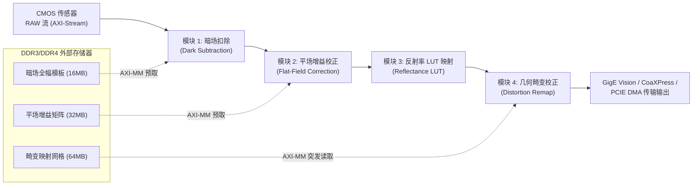

# WaferCalibSDK 在线图像实时校正 FPGA 硬件化交接与架构设计规范

- **文档密级**：内部技术交付与开发规范
- **面向对象**：FPGA 硬件开发工程师、数字 IC 设计工程师、相机嵌入式固件开发团队
- **关联算法库**：`WaferCalibSDK` (C++ / C ABI / OpenCV)
- **交付目标**：将上位机中实时运行的 **暗场校正 (Dark Field)**、**平场校正 (Flat Field)**、**反射率响应线性化 (Reflectance LUT)**、**几何畸变校正 (Distortion Correction)** 四大核心功能全面下沉（Offload）至工业相机内部 FPGA，实现零 CPU 占用、线速逐帧处理的硬件流水线引擎。

---

## 目录

- [一、 系统概述与硬件设计目标](#一-系统概述与硬件设计目标)
  - [1.1 研发背景与下沉动因](#11-研发背景与下沉动因)
  - [1.2 关键硬件指标需求 (KPI)](#12-关键硬件指标需求-kpi)
- [二、 整体硬件流水线架构 (ISP Pipeline)](#二-整体硬件流水线架构-isp-pipeline)
  - [2.1 流水线处理顺序拓扑](#21-流水线处理顺序拓扑)
  - [2.2 流水线严格顺序的物理与数学依据](#22-流水线严格顺序的物理与数学依据)
  - [2.3 视频流与控制总线标准](#23-视频流与控制总线标准)
  - [2.4 独立模块 Bypass (旁路) 机制](#24-独立模块-bypass-旁路-机制)
- [三、 模块 1：暗场底噪扣除单元 (Dark Field Correction)](#三-模块-1暗场底噪扣除单元-dark-field-correction)
  - [3.1 算法物理模型](#31-算法物理模型)
  - [3.2 定点化与逻辑实现](#32-定点化与逻辑实现)
  - [3.3 模板存储与总线访问架构](#33-模板存储与总线访问架构)
- [四、 模块 2：平场增益校正单元 (Flat Field Correction)](#四-模块-2平场增益校正单元-flat-field-correction)
  - [4.1 算法物理模型](#41-算法物理模型)
  - [4.2 定点数乘法推导 (Q2.14) 与截断保护](#42-定点数乘法推导-q214-与截断保护)
  - [4.3 DDR3/DDR4 增益矩阵高带宽流式预取架构](#43-ddr3ddr4-增益矩阵高带宽流式预取架构)
- [五、 模块 3：反射率光电响应线性化查表单元 (Reflectance LUT)](#五-模块-3反射率光电响应线性化查表单元-reflectance-lut)
  - [5.1 算法物理模型](#51-算法物理模型)
  - [5.2 双口 Block RAM (BRAM) 硬件实现](#52-双口-block-ram-bram-硬件实现)
  - [5.3 乒乓双缓冲动态无损换表时序](#53-乒乓双缓冲动态无损换表时序)
- [六、 模块 4：空间几何畸变校正单元 (Distortion Remap Engine)](#六-模块-4空间几何畸变校正单元-distortion-remap-engine)
  - [6.1 空间逆向映射数学模型](#61-空间逆向映射数学模型)
  - [6.2 硬件架构选型：Remap 映射表 + Line Buffer](#62-硬件架构选型remap-映射表--line-buffer)
  - [6.3 垂直跨度与行缓存深度推导计算](#63-垂直跨度与行缓存深度推导计算)
  - [6.4 四邻域双线性插值 (Bilinear Interpolation) 定点流水线](#64-四邻域双线性插值-bilinear-interpolation-定点流水线)
  - [6.5 边界像素填充保护 (Border Clamping)](#65-边界像素填充保护-border-clamping)
- [七、 寄存器映射与控制接口规范 (Register Map)](#七-寄存器映射与控制接口规范-register-map)
  - [7.1 AXI4-Lite 地址映射空间](#71-axi4-lite-地址映射空间)
  - [7.2 控制与状态寄存器详细定义](#72-控制与状态寄存器详细定义)
- [八、 软硬件协同验证与测试向量标准 (Bit-Exact Verification)](#八-软硬件协同验证与测试向量标准-bit-exact-verification)
  - [8.1 C++ 黄金参考模型 (Golden Model) 生成器](#81-c-黄金参考模型-golden-model-生成器)
  - [8.2 逐像素测试向量比对规范与容差门限](#82-逐像素测试向量比对规范与容差门限)

---

## 一、 系统概述与硬件设计目标

### 1.1 研发背景与下沉动因
在晶圆显微检测机台运行中，工业相机拍摄的原始图像受传感器暗电流、光学渐晕（Vignetting）、传感器光电转换非线性以及镜头几何畸变的影响，必须实时校正后才能送入后续的缺陷检测、Mark 定位或尺寸量测算法。
- **上位机现状**：当前上位机采用 CPU AVX2 指令集配合 OpenMP 并行优化，暗场+平场+LUT 流水线耗时约 `11.8 ms`，畸变校正耗时约 `5.7 ms`，合计单帧校正耗时约 `17.5 ms`；
- **下沉目标**：在 4096×4096 超大画幅、高帧率（60~100 fps）飞拍检测场景下，上位机 CPU 占用率高且易受操作系统非实时调度抖动影响。将这四项功能移至相机内部 FPGA，可实现**零主机 CPU 负载、无额外传输延迟、像素流式直出（Pixel Streaming On-the-fly）**。

### 1.2 关键硬件指标需求 (KPI)

| 指标项 | 规格要求 | 说明 |
|---|---|---|
| **输入分辨率** | 最大 $4096 \times 4096$ | 支持下采样或可变 ROI 配置（如 2048×2048, 4096×3072 等） |
| **像元位宽** | 8-bit / 10-bit / 12-bit Mono | 内部数据通路支持 12-bit 深度，输出按配置截断或定标 |
| **像素时钟频率** | $\ge 200\text{ MHz} \sim 300\text{ MHz}$ | 单像素时钟，对应吞吐率 $\ge 200\text{ Mpixels/sec}$ |
| **单帧处理延迟** | 行级实时流水线延迟 $< 100\ \mu\text{s}$ | 仅畸变校正依赖少量行缓存，其余模块均为 1~2 cycle 时延 |
| **帧率目标** | 全画幅 $4096 \times 4096$ 下 $\ge 60\text{ fps}$ | 可扩展至多像素并行（2-pixel / 4-pixel per clock）架构 |
| **硬件算法误差** | 暗场/平场/LUT: **0 LSB** (Bit-Exact)<br>畸变插值: **$\le \pm 1\text{ LSB}$** | 严格与上位机 C++ SDK 黄金模型对齐 |

---

## 二、 整体硬件流水线架构 (ISP Pipeline)

### 2.1 流水线处理顺序拓扑



### 2.2 流水线严格顺序的物理与数学依据

在 FPGA 硬件逻辑实现中，**各处理单元的级联顺序必须严格遵循上述拓扑，不可颠倒**：

1. **第一步必须执行暗场底噪扣除 (DSNU)**：
   CMOS 传感器在无光照时由于热暗电流产生的固定偏置 $D(x, y)$ 是直接叠加在光电信号上的加性直流偏置：$I_{\text{raw}}(x, y) = I_{\text{signal}}(x, y) + D(x, y)$。必须先减去 $D(x, y)$，才能保证后续的所有运算均在**纯净的光子光电响应有效信号**上进行。
2. **第二步必须执行平场增益校正 (PRNU)**：
   镜头的光学渐晕衰减（$\cos^4\theta$ 定律）及传感器各像元感光度差异是**乘性因子**。只有在扣除纯加性暗场后，信号才严格满足线性乘性模型 $I_{\text{signal}} = \Phi \cdot G(x, y)$。因此平场增益必须在暗场扣除之后立即相乘。
3. **第三步必须执行反射率光电响应线性化 (LUT)**：
   平场校正消除的是空间光照场的不均匀；而传感器本身随辐射通量增加可能存在光电饱和或微弱非线性。LUT 必须接收**空间照度均匀归一后的灰度信号**，查表映射至真实物理反射率灰度。
4. **第四步（最后一步）必须执行空间几何畸变校正 (Distortion Remap)**：
   畸变校正是空间坐标的弯曲与重采样，需要跨行、跨列读取周围 4 个邻域像素并进行空间双线性插值加权。**插值运算必须在辐射度完全均匀、无渐晕、无非线性响应的光度图像上进行**。若在插值前未做辐射校正，插值计算会将未校正的空间渐晕与噪声混合扩散，彻底破坏图像测量精度。

### 2.3 视频流与控制总线标准
- **数据通道**：标准 **AXI4-Stream (AXIS)** 协议
  - `s_axis_video_tdata[15:0]`：输入像素数据；
  - `s_axis_video_tvalid`：数据有效；
  - `s_axis_video_tready`：下游反压握手；
  - `s_axis_video_tuser`：帧起始标志 (SOF, Start of Frame，仅在每帧第一个像素拉高 1 个时钟)；
  - `s_axis_video_tlast`：行结束标志 (EOL, End of Line，在每行最后一个像素拉高 1 个时钟)。
- **控制通道**：标准 **AXI4-Lite** 协议，挂载于 SoC / MicroBlaze / 上位机 PCIe BAR 映射总线上。

### 2.4 独立模块 Bypass (旁路) 机制
每个算法模块内部均必须实现 `cfg_bypass` 寄存器位控制的多路选择器（MUX）。当某模块处于 Bypass 模式时，数据流直接直通输出，仅产生 1 cycle 的同步流水时延，确保工程现场分步联调及排查故障。

---

## 三、 模块 1：暗场底噪扣除单元 (Dark Field Correction)

### 3.1 算法物理模型
$$I_{\text{sub}}(x, y) = \max\Big(0,\ I_{\text{in}}(x, y) - D(x, y)\Big)$$
其中：
- $I_{\text{in}}(x, y)$：当前帧输入的 Mono8/Mono10/Mono12 原始灰度；
- $D(x, y)$：离线采集多帧（通常 32~64 帧）在完全遮光条件下均值化得到的无偏暗场底噪模板。

### 3.2 定点化与逻辑实现
- **位宽扩展**：输入为无符号数，减法器内部需符号位扩展 1 位。以 8-bit 为例，输入扩展为 9-bit 有符号数：
  $$\text{diff}[8:0] = \{1'b0, I_{\text{in}}[7:0]\} - \{1'b0, D[7:0]\}$$
- **负数下溢截断 (Underflow Clamping)**：
  当 $\text{diff}[8] == 1'b1$（最高符号位为 1，说明结果为负），强制截断输出 `8'd0`；否则输出低 8 位 $\text{diff}[7:0]$。
- **流水级数**：1 个时钟周期完成减法与下溢比较。

### 3.3 模板存储与总线访问架构
1. **全画幅存储需求**：$4096 \times 4096 \times 1\text{ Byte} = 16\text{ MB}$。
2. **外部内存布局**：存放在相机板载 DDR3/DDR4 的专用保留地址段（如 `0x1000_0000`）。
3. **流式 AXI-MM 突发预取**：
   - 内部设计深度为 $2048 \times 8\text{-bit}$ 的双异步 FIFO（Ping-Pong / AXI Data Mover FIFO）；
   - 在每行视频流开始前，通过 AXI Master 发起长度为 256 beats（每拍 64-bit 或 128-bit）的突发读取，将暗场模板预取至 FIFO；
   - 视频流到来时，FIFO 与像素时钟完全同步出队。

---

## 四、 模块 2：平场增益校正单元 (Flat Field Correction)

### 4.1 算法物理模型
$$I_{\text{ffc}}(x, y) = \min\Big(255,\ \text{round}\big(I_{\text{sub}}(x, y) \times G(x, y)\big)\Big)$$
其中 $G(x, y)$ 为 32 位浮点增益系数，典型范围为 $[0.8, 3.5]$。

### 4.2 定点数乘法推导 (Q2.14) 与截断保护
在 FPGA 中禁止浮点运算，增益系数定点化为 **$Q2.14$ 无符号定点数**（共 16 位：2 位整数位，14 位小数位，分辨率 $\Delta = 2^{-14} \approx 6.1 \times 10^{-5}$，最大表示范围 $0 \sim 3.9999$）：

$$G_{\text{fix}}[15:0] = \text{round}\big(G(x, y) \times 16384\big)$$

- **硬件乘法实现（基于 DSP48）**：
  - 输入像素：$I_{\text{sub}}[7:0]$（8 位无符号数）；
  - 增益系数：$G_{\text{fix}}[15:0]$（16 位无符号数）；
  - 乘积结果：$\text{prod}[23:0] = I_{\text{sub}}[7:0] \times G_{\text{fix}}[15:0]$（24 位无符号数）；
- **四舍五入与定标**：
  在移位前加上半位权重（即加上 $2^{13} = 8192$），然后右移 14 位：
  $$\text{val}[9:0] = \big(\text{prod}[23:0] + 24'd8192\big) \gg 14$$
- **高位溢出保护 (Saturation Clamping)**：
  若 $\text{val}[9:8] \ne 2'b00$（即乘法结果超过 255），强制输出 `8'd255`；否则输出 $\text{val}[7:0]$。

### 4.3 DDR3/DDR4 增益矩阵高带宽流式预取架构
- **数据量**：$4096 \times 4096 \times 2\text{ Bytes (Q2.14)} = 32\text{ MB}$。
- **带宽匹配**：全画幅 60 fps 时，带宽需求为 $32\text{ MB} \times 60 = 1.92\text{ GB/s}$。
- 相机板载 32-bit DDR4 @ 1200MHz 可提供峰值带宽 $\approx 9.6\text{ GB/s}$，利用率不到 25%，完全可与 AXI Video DMA 并行运行。

---

## 五、 模块 3：反射率光电响应线性化查表单元 (Reflectance LUT)

### 5.1 算法物理模型
$$I_{\text{out}}(x, y) = \text{LUT}\big[I_{\text{ffc}}(x, y)\big]$$
LUT 映射表包含 256 个元素（对应 Mono8），数组索引为输入灰度 $0 \sim 255$，值为校正后的线性物理反射率目标灰度值。

### 5.2 双口 Block RAM (BRAM) 硬件实现
- **存储规格**：深度 256，位宽 8-bit（仅需半片 18K BRAM 或分布式 LUT RAM 即可实现）；
- **端口配置**：
  - **Port A (只读，像素时钟域 `clk_pixel`)**：地址连接 $I_{\text{ffc}}[7:0]$，读数据即为 $I_{\text{out}}[7:0]$，固定 1 个时钟周期的确定性读取时延；
  - **Port B (只写，控制时钟域 `clk_axi`)**：用于上位机通过 AXI-Lite 动态下载更新 LUT 数据。

### 5.3 乒乓双缓冲动态无损换表时序
为了防止机台在线切倍率或换批次时在图像正中央更新 LUT 造成撕裂：
1. 硬件例化两个 LUT RAM（LUT_Ping 与 LUT_Pong）；
2. 上位机 AXI-Lite 始终写入非激活的 RAM；
3. 上位机发起更新使能后，硬件等待下一次 `s_axis_video_tuser`（帧起始信号 SOF）到来的消隐期，在硬件级别瞬时切换读地址指针，实现**跨帧无缝原子切换**。

---

## 六、 模块 4：空间几何畸变校正单元 (Distortion Remap Engine)

> [!IMPORTANT]
> **几何畸变校正是四项功能中逻辑最复杂、硬件资源消耗最大的模块！**

### 6.1 空间逆向映射数学模型
设无畸变目标图像中的整数字坐标为 $(x_{\text{dst}}, y_{\text{dst}})$，其在原始有畸变图像中对应的亚像素连续坐标为 $(u_{\text{src}}, v_{\text{src}})$。
二维三阶多项式模型定义为：
$$u_{\text{src}} = \sum_{i+j \le 3} C_x(i, j) \cdot x_{\text{dst}}^i \cdot y_{\text{dst}}^j, \quad v_{\text{src}} = \sum_{i+j \le 3} C_y(i, j) \cdot x_{\text{dst}}^i \cdot y_{\text{dst}}^j$$

### 6.2 硬件架构选型：Remap 映射表 + Line Buffer
- **为什么不直接用 FPGA 算多项式？**
  三阶多项式包含 10 个交叉乘积项，双通道需 20 个高精度浮点乘法器，且存在迭代截断误差；
- **推荐架构（上位机 SDK 5.7ms 极速版同款硬件映射）**：
  上位机在标定完成或加载模板时，将全画幅每个像素的相对偏移量 $\big(\Delta u(x, y), \Delta v(x, y)\big)$ 预先计算好，生成定点网格映射表下载到相机的 DDR4 中：
  $$\Delta u = u_{\text{src}} - x_{\text{dst}}, \quad \Delta v = v_{\text{src}} - y_{\text{dst}}$$
  FPGA 仅需读取 DDR4 中的二维偏移矢量，与内部自增的 $(x_{\text{dst}}, y_{\text{dst}})$ 相加，即可得到源图像坐标。

### 6.3 垂直跨度与行缓存深度推导计算
因为光学镜头的纵向畸变偏移量有限（根据 SDK 实测，显微物镜的最大径向畸变一般 $< 32$ 像素）：
1. **最大垂直位移量 $\Delta v_{\max}$**：设定硬件支持的最大纵向位移为 $\pm 32$ 行；
2. **Line Buffer 资源计算**：
   - 内部需要维护一个滑动窗口行缓存池（FIFO 组），深度为：$H_{\text{buffer}} = 2 \times |\Delta v_{\max}| + 2 = 66\text{ 行}$；
   - 每行宽度 4096 字节，总 Block RAM 需求：$66 \times 4096 = 270\text{ KB}$（约需 120 片 36K BRAM，完全在主流 Xilinx Kintex-7 / Zynq UltraScale+ 承载范围内）；
3. **控制机制**：
   输入像素流不断推入 Line Buffer，当缓存行数超过 33 行时，畸变校正引擎开始从行缓存中根据 $v_{\text{src}}$ 寻址读取数据并输出，整机硬件延迟仅为 **33 行时间（约 $30\ \mu\text{s}$）**。

### 6.4 四邻域双线性插值 (Bilinear Interpolation) 定点流水线

设目标像素映射到源图像的亚像素坐标为 $(u, v)$：
- 整数部分：$u_0 = \lfloor u \rfloor,\ v_0 = \lfloor v \rfloor$；
- 小数权重（定点化为 8-bit $Q0.8$）：
  $$w_x[7:0] = \text{round}\big((u - u_0) \times 256\big), \quad w_y[7:0] = \text{round}\big((v - v_0) \times 256\big)$$
  $$(1 - w_x) = 256 - w_x, \quad (1 - w_y) = 256 - w_y$$
- **读取四邻域像素**：
  从相邻两行 Line Buffer 中并行读出 4 个相邻像素值：
  $P_{00} = I(u_0, v_0)$， $P_{10} = I(u_0 + 1, v_0)$， $P_{01} = I(u_0, v_0 + 1)$， $P_{11} = I(u_0 + 1, v_0 + 1)$。
- **硬件三级流水线插值结构**：
  1. **Stage 1 (水平方向加权)**：
     $$S_0 = P_{00} \cdot (256 - w_x) + P_{10} \cdot w_x$$
     $$S_1 = P_{01} \cdot (256 - w_x) + P_{11} \cdot w_x$$
  2. **Stage 2 (垂直方向加权)**：
     $$T = S_0 \cdot (256 - w_y) + S_1 \cdot w_y$$
  3. **Stage 3 (定标与截断输出)**：
     $$I_{\text{corrected}} = (T + 32768) \gg 16$$

### 6.5 边界像素填充保护 (Border Clamping)
当多项式映射坐标 $(u, v)$ 超出有效像面边界 $[0, \text{Width}-1] \times [0, \text{Height}-1]$ 时：
- 提供寄存器配置模式：
  - `00`：常数填充（恒定输出 0，纯黑边缘）；
  - `01`：复制边缘像素（Replicate Border，取边界最近有效像素）；
  - 推荐默认设为模式 `00`（纯黑），与上位机 SDK 行为保持完全一致。

---

## 七、 寄存器映射与控制接口规范 (Register Map)

### 7.1 AXI4-Lite 地址映射空间
基地址（Base Address）：`0x43C0_0000`（按实际 Vivado Address Editor 分配）。

| 偏移地址 | 寄存器名称 | 读写属性 | 复位默认值 | 功能描述 |
|---|---|---|---|---|
| `0x000` | `GLOBAL_CTRL` | R/W | `0x0000_0000` | 全局使能、软复位与调试触发控制 |
| `0x004` | `BYPASS_REG` | R/W | `0x0000_000F` | 各功能模块独立旁路掩码 (默认全旁路直通) |
| `0x008` | `FRAME_WIDTH` | R/W | `0x0000_1000` | 图像宽度（默认 4096） |
| `0x00C` | `FRAME_HEIGHT` | R/W | `0x0000_1000` | 图像高度（默认 4096） |
| `0x010` | `DARK_BASE_ADDR` | R/W | `0x1000_0000` | 暗场模板在 DDR 中的起始物理地址 |
| `0x014` | `FFC_BASE_ADDR` | R/W | `0x1200_0000` | 平场增益矩阵在 DDR 中的起始物理地址 |
| `0x018` | `REMAP_BASE_ADDR` | R/W | `0x1400_0000` | 畸变校正网格映射表在 DDR 中的起始物理地址 |
| `0x020` | `LUT_ADDR_PORT` | W | `0x0000_0000` | 反射率 LUT 写入索引寄存器 ($0 \sim 255$) |
| `0x024` | `LUT_DATA_PORT` | W | `0x0000_0000` | 反射率 LUT 写入数据寄存器 ($0 \sim 255$) |
| `0x028` | `LUT_SWAP_CTRL` | R/W | `0x0000_0000` | 乒乓 LUT 切换触发位 (写 1 触发下一帧换表) |
| `0x030` | `DISTORTION_CTRL`| R/W | `0x0000_0000` | 畸变边界填充模式选择与最大偏移阈值 |
| `0x040` | `STATUS_REG` | RO | `0x0000_0000` | 流水线状态（FIFO 满溢告警、帧同步指示） |

### 7.2 控制与状态寄存器详细定义

#### `BYPASS_REG` (偏移 `0x004`)
- `Bit[0]`：`DARK_BYPASS`（1: 旁路暗场扣除，0: 使能暗场扣除）；
- `Bit[1]`：`FFC_BYPASS`（1: 旁路平场校正，0: 使能平场校正）；
- `Bit[2]`：`LUT_BYPASS`（1: 旁路反射率 LUT，0: 使能反射率 LUT）；
- `Bit[3]`：`DISTORT_BYPASS`（1: 旁路畸变校正，0: 使能畸变校正）。

---

## 八、 软硬件协同验证与测试向量标准 (Bit-Exact Verification)

为了确保 FPGA 开发人员能快速闭环仿真，SDK 团队已建立配套的**黄金测试向量生成机制**：

### 8.1 C++ 黄金参考模型 (Golden Model) 生成器
上位机测试套件可导出专供 Modelsim / Vivado 仿真激励的二进制测试集：
1. **输入激励文件**：
   - `sim_raw_input.bin`：原始相机采集 Mono8 图像文件（$4096 \times 4096$ 字节）；
   - `sim_dark_template.bin`：暗场模板（16MB）；
   - `sim_gain_q14.bin`：定点化 $Q2.14$ 平场增益矩阵（32MB）；
   - `sim_lut_256.hex`：256 元素十六进制 LUT 表（供 `$readmemh` 载入 BRAM）；
   - `sim_remap_grid.bin`：定点化畸变逆映射偏移网格。
2. **黄金参考输出文件**：
   - `golden_step1_dark_out.bin`：暗场扣除后标准输出；
   - `golden_step2_ffc_out.bin`：平场校正后标准输出；
   - `golden_step3_lut_out.bin`：LUT 映射后标准输出；
   - `golden_step4_final_out.bin`：全流程结束后的最终图像。

### 8.2 逐像素测试向量比对规范与容差门限

```text
       ┌──────────────┐
       │ sim_raw_input│
       └──────┬───────┘
              │
       ┌──────┴────────────────┐
       ▼                       ▼
┌──────────────┐        ┌──────────────┐
│  C++ SDK 黄金│        │  FPGA 仿真/  │
│  参考模型输出 │        │  板级抓包输出 │
└──────┬───────┘        └──────┬───────┘
       │                       │
       └──────────┬────────────┘
                  ▼
          [逐像素绝对残差比对]
```

- **暗场扣除 (Dark Field)**：允许误差 = **0 LSB**（位级 100% 相同）；
- **平场校正 (FFC)**：允许误差 = **0 LSB**（定点 $Q2.14$ 截断加 0.5 舍入，位级 100% 相同）；
- **LUT 映射 (Reflectance LUT)**：允许误差 = **0 LSB**（查表无损，位级 100% 相同）；
- **畸变校正 (Distortion)**：
  - 由于双线性插值在定点移位与浮点四舍五入之间存在微小精度截断，允许误差 **$\le \pm 1\text{ LSB}$**；
  - 允许误差达到 $\pm 1$ 的像素数量比例必须 $< 0.05\%$，无任何宏观条纹与空间位错。

---

## 交付附件与支持联系

1. **配套配方生成代码**：请参阅 `WaferCalibSDK/src/modules/` 对应源代码与定点数导出工具；
2. **测试数据下载**：校正配方与测试图请参考工程 `test/` 与 `images/` 目录；
3. **技术支持**：如遇定点位宽溢出或多项式网格插值疑问，可随时与算法团队沟通联合仿真联调。
